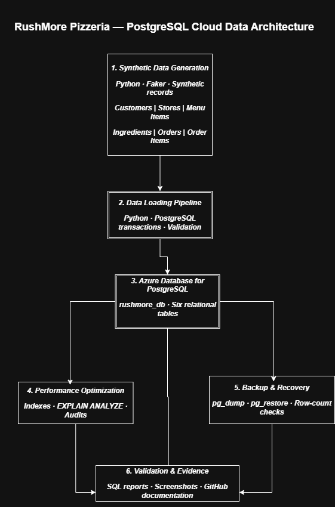
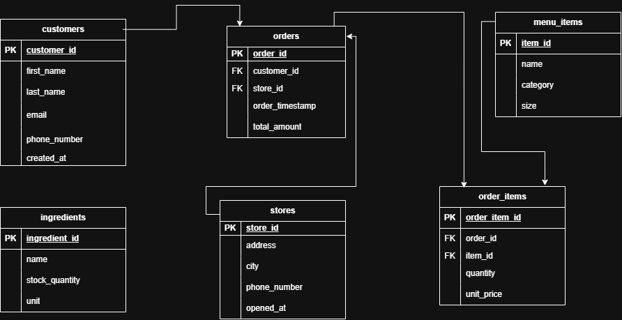

# RushMore Pizzeria — PostgreSQL Database Engineering Capstone

**Relational database design · Synthetic data engineering · Azure PostgreSQL · SQL optimization · Backup and recovery**

RushMore is a PostgreSQL database engineering case study for a fictional pizzeria operation. It demonstrates a six-table relational model, Python/Faker synthetic-data generation, transactional loading into Azure Database for PostgreSQL, integrity validation, query-plan analysis, index administration, and backup/restore verification. All application data is synthetic.

## Architecture

### System architecture



### Entity relationship diagram



The six application tables are `customers`, `stores`, `menu_items`, `ingredients`, `orders`, and `order_items`. The four verified foreign-key relationships are:

- `orders.customer_id` → `customers.customer_id`
- `orders.store_id` → `stores.store_id`
- `order_items.order_id` → `orders.order_id`
- `order_items.item_id` → `menu_items.item_id`

`ingredients` is a standalone inventory catalog in this prototype; no ingredient-to-menu-item recipe relationship is claimed. The ERD is a visual aid; the deployed PostgreSQL schema and constraint audit are authoritative.

## Technology

- **Database:** PostgreSQL on Azure Database for PostgreSQL
- **Data generation/loading:** Python, Faker, psycopg2
- **Database administration:** pgAdmin 4, SQL, `pg_dump`, `pg_restore`
- **Performance analysis:** PostgreSQL indexes, `EXPLAIN (ANALYZE, BUFFERS)`, catalog inspection
- **Documentation/version control:** Markdown, draw.io, GitHub

## Demonstrated outcomes

| Outcome | Recorded result |
|---|---:|
| Application tables | 6 |
| Synthetic rows loaded and validated | 126,085 |
| Phase 03 quality/integrity checks | 12 passed; 0 detected violations |
| Foreign-key relationships verified | 4 |
| Indexes in retained orders/order_items health audit | 7 valid and ready |
| Backup/restore | Command-line restore exit code 0 |
| Source vs. recovered database | 126,085 rows each across 6 tables; 0 count discrepancies |

These are scoped project results, not claims of production readiness or exhaustive row-level equality. See the linked reports for provenance and limitations.

### Synthetic dataset

| Table | Rows |
|---|---:|
| customers | 6,000 |
| ingredients | 50 |
| menu_items | 30 |
| order_items | 90,000 |
| orders | 30,000 |
| stores | 5 |
| **Total** | **126,085** |

## Engineering workflow

### Phase 03 — Synthetic generation, cloud loading and validation

The Python/Faker pipeline generates relationally consistent training records and loads them transactionally into `rushmore_db`. The loader refuses to populate nonempty application tables to reduce accidental duplication. Validation covers referential integrity, missing/duplicate values, quantities, prices, and order-total reconciliation.

**Evidence:** [Phase 03 validation report](docs/VALIDATION_REPORT.md).

### Phase 04 — Administration and query performance

The project inspects index health and uses PostgreSQL query plans to examine order history and order-item lookups. A recorded `order_items` lookup with `order_id = 100` used `idx_order_items_order_id` and returned three rows with three shared buffer hits. The retained performance report records an execution-time observation of 0.049 ms for a user-supplied result; that observation does **not** establish a reproducible comparative speedup.

Historical multi-run comparison evidence is incomplete. Some diagnostic SQL files change planner settings, and certain scripts include executable DDL or incomplete transaction handling. **Do not run all Phase 04 scripts as a batch**; inspect their contents and the documented limitations first.

**Evidence:** [Performance and evidence report](docs/PHASE04_PERFORMANCE_REPORT.md) · [Evidence audit](docs/PHASE04_EVIDENCE_AUDIT.md) · [Completion assessment](docs/PHASE04_COMPLETION_ASSESSMENT.md).

### Backup and recovery

A custom-format PostgreSQL backup was restored to a separate Azure database, `rushmore_recovery_final`, without overwriting `rushmore_db`. The final command-line restore returned exit code `0`. Independent table-count checks on the source and recovered databases each totaled 126,085 rows across six tables, with no count discrepancies. Full row-level checksums and recovery-time objectives were not established.

**Evidence:** [Recovery report and screenshots](docs/PHASE04_RECOVERY_REPORT.md).

## Local setup (PowerShell)

**Prerequisites:** Python 3.10+, access to a PostgreSQL database with the Phase 02 schema deployed, and appropriately restricted Azure firewall/network access.

From the repository root:

```powershell
py -m venv .venv
.\.venv\Scripts\Activate.ps1
python -m pip install -r requirements.txt
Copy-Item .env.example .env
```

Set your own database connection values in `.env`. **Never commit `.env`, credentials, connection secrets, or private backup files.**

To preview synthetic-data generation, then load **only into an approved empty training database**:

```powershell
python populate.py --dry-run
python populate.py --load
```

Wait for the loader's successful commit confirmation. Run the checks in `verification.sql` through pgAdmin or another PostgreSQL client, and compare the results against the [validation report](docs/VALIDATION_REPORT.md).

**Destructive option:** `python populate.py --load --reset-synthetic` deletes all rows from the six application tables before loading and requires typed confirmation. Use it only on disposable training data; never on a database containing valuable records.

## Data and design notes

- Fake customer email addresses use `example.com`; phone numbers are synthetic identifiers, not verified dialable numbers.
- Faker first and last names are generated separately to match the schema.
- The `menu_items` table has no price field; historical `order_items.unit_price` values are the prototype's authoritative sales prices, reconciled against `orders.total_amount`.
- The project does not implement a recipe mapping between `ingredients` and `menu_items`.
- This is an educational prototype, not a live pizzeria system. Azure resources may incur charges even when compute is stopped.

## Reports and visual evidence

- [Phase 03 validation](docs/VALIDATION_REPORT.md)
- [Phase 04 performance](docs/PHASE04_PERFORMANCE_REPORT.md)
- [Phase 04 evidence audit](docs/PHASE04_EVIDENCE_AUDIT.md)
- [Phase 04 recovery and final sign-off](docs/PHASE04_RECOVERY_REPORT.md)
- [Phase 04 completion assessment and remaining limitations](docs/PHASE04_COMPLETION_ASSESSMENT.md)
- [Architecture diagrams](docs/architecture/)
- [Execution screenshots](RushMore-Screenshots/)

## Scope and limitations

The project demonstrates a working synthetic-data pipeline, validated relational constraints, observed index usage, and tested backup restoration with matching table counts. It does **not** claim production availability, comprehensive benchmark reproducibility, complete historical performance evidence, row-by-row restore equality, or a measured recovery-time objective. The [completion assessment](docs/PHASE04_COMPLETION_ASSESSMENT.md) identifies remaining evidence and SQL-procedure improvements.

## Repository

[DevDataMLOps/RushMore-PostgreSQL-Database-Engineering](https://github.com/DevDataMLOps/RushMore-PostgreSQL-Database-Engineering)
