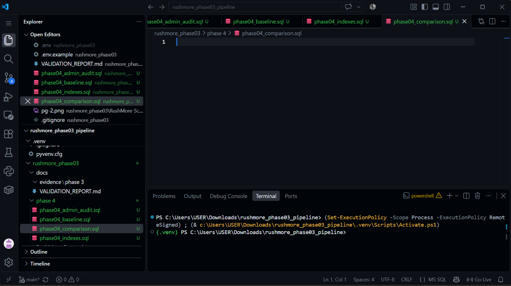
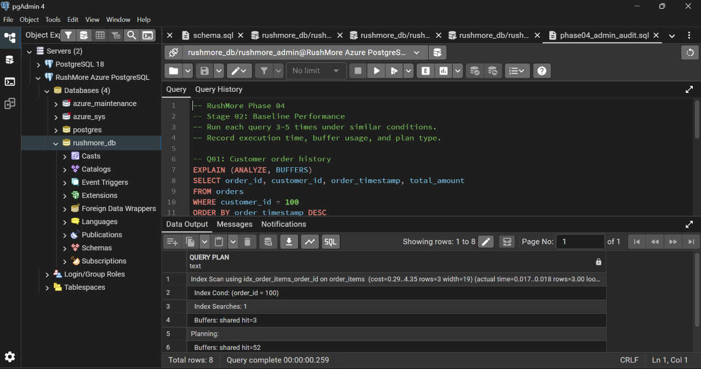
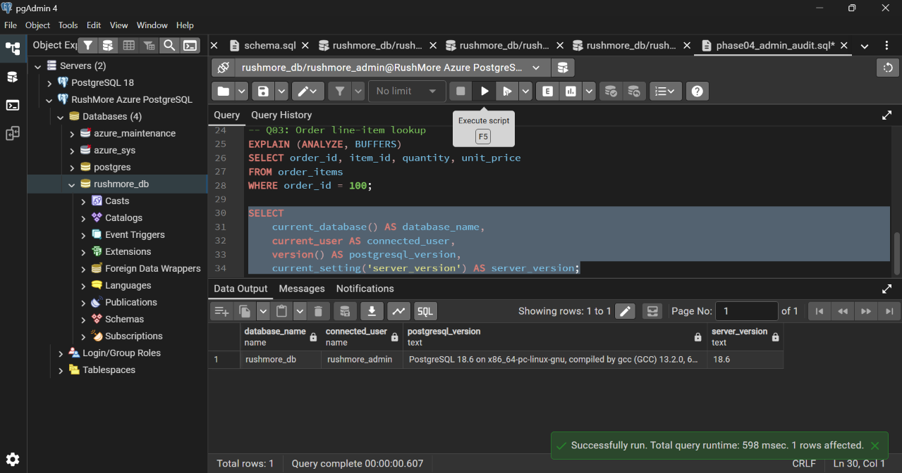
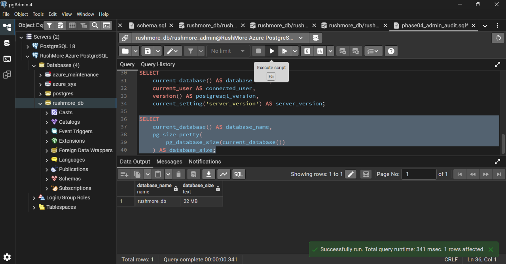
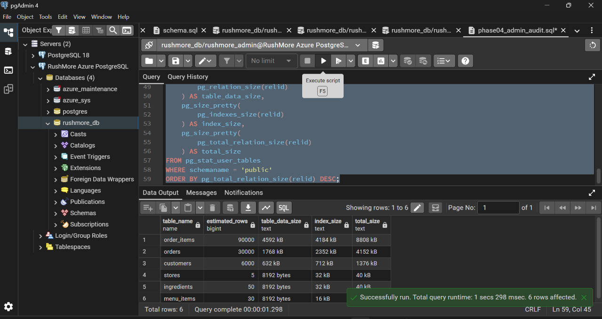
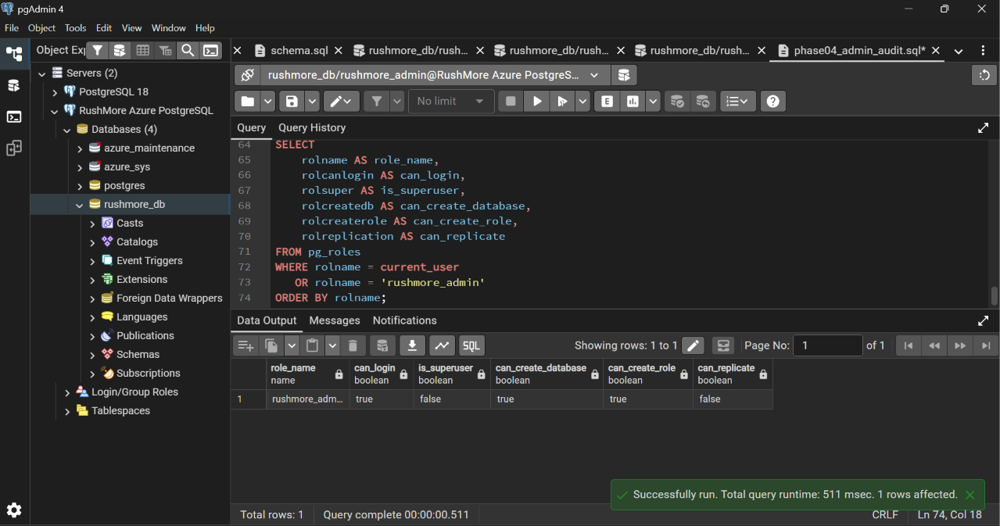
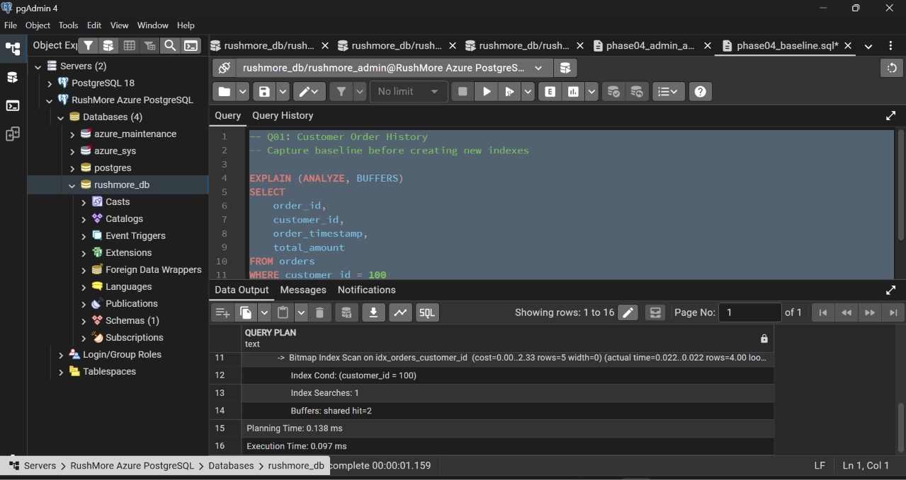
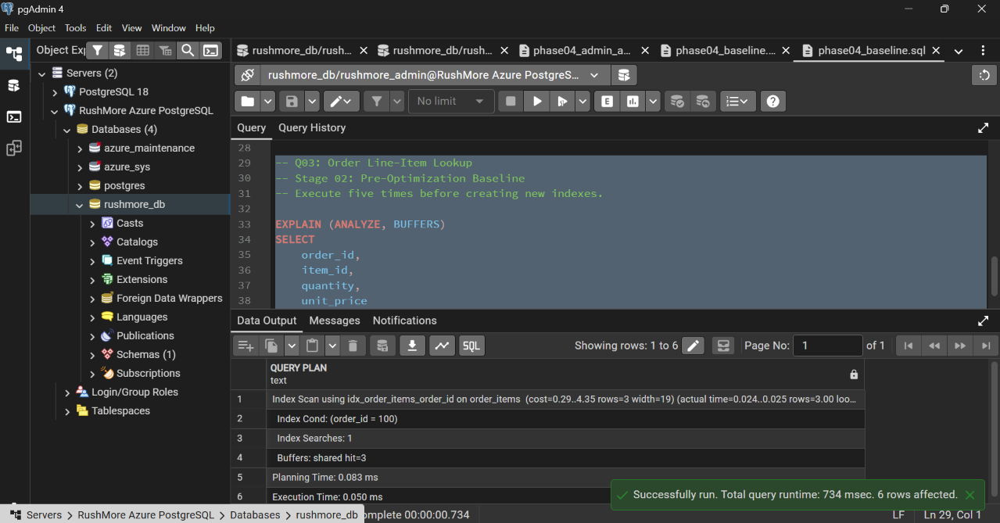

**Phase:** 04 — PostgreSQL Administration & Performance Engineering
**Status:** In Progress
**Stage 01:** PostgreSQL Administration Baseline — Completed
**Stage 02:** Baseline Performance Benchmarking — In Progress (Q01 completed)
**Stage 03:** Index Engineering — Pending
**Stage 04:** Performance Comparison — Pending

# RushMore — Phase 04 Performance Engineering Report

**Project:** RushMore PostgreSQL Database Engineering  
**Phase:** 04 — PostgreSQL Administration & Performance Engineering  
**Database:** `rushmore_db`  
**Platform:** Azure Database for PostgreSQL  
**PostgreSQL Version:** 18.6  
**Status:** Stage 01 completed; Stage 02 in progress (Q01 baseline completed)

---

## 1. Executive Summary

RushMore Phase 04 evaluates PostgreSQL database administration, query execution efficiency, indexing strategies, and performance optimization.

The objective is to demonstrate practical database engineering capabilities through measurable evidence rather than relying solely on successful SQL execution.

The phase includes:

1. PostgreSQL administration and health auditing.
2. Baseline SQL query performance benchmarking.
3. Index design and implementation.
4. Before-and-after performance comparisons.
5. Documentation of execution plans, buffer utilization, and optimization trade-offs.

The initial database contains **126,085 synthetic records across six relational tables**, successfully loaded and validated during Phase 03.

## 2. Stage 01 — PostgreSQL Administration Baseline

**Status: Completed**

### 2.1 Database Environment

| Metric | Observed Result |
|---|---|
| Database | `rushmore_db` |
| Database platform | Azure PostgreSQL |
| PostgreSQL version | 18.6 |
| Database size | 22 MB |
| Application tables | 6 |
| Existing indexes | 14 |
| Connected database role | `rushmore_admin` |

### 2.2 Database Table Inventory

| Table | Records |
|---|---:|
| stores | 5 |
| customers | 6,000 |
| ingredients | 50 |
| menu_items | 30 |
| orders | 30,000 |
| order_items | 90,000 |
| **Total** | **126,085** |

### 2.3 Database Role and Privilege Audit

The connected role was inspected using PostgreSQL system catalogs and privilege-checking functions.

| Privilege | Observed Result |
|---|---|
| LOGIN | True |
| SUPERUSER | False |
| CREATEDB | True |
| CREATEROLE | True |
| REPLICATION | False |
| Database CONNECT | True |
| Database CREATE | True |
| Database TEMP | True |

**Interpretation:** The connected administrative role has database and role management capabilities but is not a PostgreSQL superuser.

A future production deployment should separate administrative permissions from application runtime permissions and apply least-privilege access controls.

### 2.4 Connection Activity

| Connection State | Count |
|---|---:|
| Idle | 6 |
| Active | 1 |
| Total | 7 |

This is a point-in-time connection snapshot and does not establish peak connection utilization.

### 2.5 Transaction and Cache Statistics

| Metric | Observed Result |
|---|---:|
| Committed transactions | 4,225 |
| Rolled-back transactions | 1 |
| Disk blocks read | 14 |
| Cache blocks hit | 2,320,827 |

The observed cache activity suggests substantial reuse of cached database blocks.

These cumulative statistics should not be interpreted as individual query performance measurements.

### 2.6 Index Inventory

The audit identified **14 existing indexes** across the six application tables.

The inventory includes primary-key and unique-constraint indexes.

Before creating new indexes, Phase 04 will assess:

- Existing index coverage.
- Query predicates and sorting requirements.
- Sequential versus index scan behavior.
- Additional storage overhead.
- Potential write-performance trade-offs.

### 2.7 Vacuum and Maintenance

PostgreSQL maintenance statistics were inspected using `pg_stat_user_tables`.

Observed findings:

- Six application tables were inspected.
- Visible estimated dead-row counts were zero.
- Autovacuum activity was recorded for several larger tables.
- Some maintenance timestamps were null.

These results establish an initial maintenance snapshot, not proof of long-term production health.

### 2.8 Administration Audit Conclusion

All six planned Stage 01 administration checks executed successfully.

The audit establishes a baseline for database configuration, privileges, connection activity, storage, indexing, and maintenance.

**Stage 01 Result: Completed.**

---

## 3. Stage 02 — Baseline Query Performance

### Stage 02 — Baseline Performance Benchmarking

**Status:** In Progress  
**Database:** `rushmore_db`  
**Platform:** Azure Database for PostgreSQL 18.6  
**Benchmark tool:** pgAdmin 4 / `EXPLAIN (ANALYZE, BUFFERS)`  
**Optimization status:** Pre-optimization baseline

#### Q01 — Customer Order History

**Objective:** Measure customer order-history retrieval performance before introducing additional indexes.

**Benchmark methodology:**

- Execute the same SQL query five times under similar conditions.
- Record PostgreSQL execution time and planning time.
- Inspect execution-plan operators and buffer activity.
- Use median execution time as the primary comparison metric.
- Preserve the original baseline before implementing new indexes.

**Baseline measurements**

| Run | Execution Time (ms) | Planning Time (ms) |
|---|---:|---:|
| 1 | 0.103 | 0.339 |
| 2 | 0.160 | 0.181 |
| 3 | 0.074 | 0.108 |
| 4 | 0.104 | 0.110 |
| 5 | 0.097 | 0.138 |
| **Median** | **0.103** | **0.138** |
| **Mean** | **0.108** | **0.175** |

#### Execution Plan Observations

The baseline execution plan demonstrates:

- **Access method:** Bitmap Index Scan with Bitmap Heap Scan.
- **Existing index:** `idx_orders_customer_id`.
- **Index condition:** `customer_id = 100`.
- **Index searches:** 1.
- **Matching rows:** 4 in the observed executions.
- **Sorting:** `order_timestamp DESC` using quicksort.
- **Index scan buffer hits:** 2 in the captured execution plan.
- **Run 5 execution time:** 0.097 ms.

**Interpretation:**

PostgreSQL already uses an existing index to locate the customer's orders. The query also performs a sorting operation to return the most recent orders first.

The existing index provides an effective starting point. Any proposed composite index must demonstrate measurable improvements in execution time, execution-plan behavior, or buffer usage.

Because the query already executes in approximately 0.1 milliseconds, additional indexes may provide limited benefits and introduce write or storage overhead.

#### Baseline Summary

| Metric | Baseline |
|---|---|
| Benchmark executions | 5 |
| Median execution time | 0.103 ms |
| Mean execution time | 0.108 ms |
| Fastest execution | 0.074 ms |
| Slowest execution | 0.160 ms |
| Existing index | `idx_orders_customer_id` |
| Optimization status | Not yet performed |

**Conclusion:**

Q01 baseline benchmarking has been completed successfully. These measurements represent the **pre-optimization baseline** and will serve as the reference for Stage 04 performance comparisons.

No performance improvement or speedup is claimed at this stage.

**Next:** Complete Q02 and Q03 baseline measurements before implementing and evaluating proposed indexes.

### 3.1 Objective

Measure existing query performance before introducing new optimization indexes.

### 3.2 Benchmark Methodology

Each benchmark query will be executed using:

```sql
EXPLAIN (ANALYZE, BUFFERS)
```

For each query:

1. Confirm the database and dataset remain unchanged.
2. Record the existing execution plan.
3. Execute the query five times under similar conditions.
4. Record planning time and execution time separately.
5. Capture shared buffer hits, reads, and writes where reported.
6. Calculate the median execution time.
7. Preserve query-plan screenshots or text output.

The same query parameters, database environment, and measurement procedure will be used for post-index comparisons.

### 3.3 Benchmark Workloads

| Query | Workload | Baseline |
|---|---|---|
| Q01 | Customer order history | Completed — median 0.103 ms |
| Q02 | Sales aggregation | Pending |
| Q03 | Order line-item lookup | Pending |

### 3.4 Baseline Measurement Table

| Query | Run 1 | Run 2 | Run 3 | Run 4 | Run 5 | Median (ms) |
|---|---:|---:|---:|---:|---:|---:|
| Q01 | 0.103 | 0.160 | 0.074 | 0.104 | 0.097 | **0.103** |
| Q02 | — | — | — | — | — | — |
| Q03 | — | — | — | — | — | — |

All timings will use PostgreSQL's reported execution time in milliseconds, not pgAdmin's total query runtime.

---

## 4. Stage 03 — Index Engineering

**Status: Pending baseline results**

### 4.1 Objective

Design and evaluate indexes that improve representative query workloads.

### 4.2 Index Change Log

| Index Name | Table | Columns | Target Query | Status |
|---|---|---|---|---|
| To be determined | — | — | Q01 | Pending |
| To be determined | — | — | Q02 | Pending |
| To be determined | — | — | Q03 | Pending |

Only indexes justified by the baseline execution plans will be implemented.

### 4.3 Index Evaluation Criteria

Each index will be evaluated for:

- Query execution time improvements.
- Changes in execution plan.
- Shared buffer usage.
- Index storage overhead.
- Potential impact on INSERT, UPDATE, and DELETE operations.

Index creation alone will not be considered evidence of successful optimization.

---

## 5. Stage 04 — Before-and-After Performance Comparison

**Status: Pending**

### 5.1 Performance Results

| Query | Baseline Median (ms) | Optimized Median (ms) | Improvement (%) |
|---|---:|---:|---:|
| Q01 | — | — | — |
| Q02 | — | — | — |
| Q03 | — | — | — |

### 5.2 Improvement Formula

Performance improvement will be calculated as:

```text
Improvement (%) =
((Baseline Median - Optimized Median) / Baseline Median) × 100
```

A negative value indicates that the optimized query was slower.

### 5.3 Execution Plan Comparison

For each query, document:

**Before optimization**
- Scan or join strategy:
- Index usage:
- Planning time:
- Execution time:
- Shared buffers:

**After optimization**
- Scan or join strategy:
- Index usage:
- Planning time:
- Execution time:
- Shared buffers:

**Interpretation:** Pending measurements.

---

## 6. Evidence and Reproducibility

### 6.1 SQL Artifacts

- `phase 4/phase04_admin_audit.sql`
- `phase 4/phase04_baseline.sql`
- `phase 4/phase04_indexes.sql`
- `phase 4/phase04_comparison.sql`

### 6.2 Evidence Requirements

Preserve evidence showing:

1. PostgreSQL administration and connection statistics.
2. Existing index inventory and maintenance statistics.
3. Baseline execution plans.
4. Index implementation results.
5. Optimized execution plans and comparative measurements.

All screenshots must be captured from actual executions and stored in the repository.

### 6.3 Reproducibility Limitations

The benchmark results will represent the specific Azure PostgreSQL environment, dataset, workload, and execution conditions used during testing.

They should not be generalized to production-scale performance without additional workload testing.

---

## 7. Engineering Conclusions

**Stage 01:** Administration baseline completed.

**Stage 02:** In progress — Q01 baseline completed (median 0.103 ms); Q02 and Q03 pending.

**Stage 03:** Index engineering pending.

**Stage 04:** Comparative validation pending.

The final report will summarize measured performance improvements, index effectiveness, observed limitations, and recommendations for further PostgreSQL administration and performance engineering.

**Overall Phase 04 Status: In Progress.**


### PostgreSQL Connection


### Database Size


### Table Storage


### Database Privileges


### Connection and Transaction Statistics


### Index and Maintenance Audit


#### Q01 — Baseline Execution Evidence



### Q02 — Sales Aggregation: Pre-Optimization Baseline

**Database:** `rushmore_db`  
**Platform:** Azure Database for PostgreSQL  
**Benchmark method:** Five executions using `EXPLAIN (ANALYZE, BUFFERS)`  
**Optimization status:** No new Phase 04 indexes applied

#### Execution Time Results

| Run | Execution Time (ms) |
|---|---:|
| 1 | 229.273 |
| 2 | 18.918 |
| 3 | 18.616 |
| 4 | 19.842 |
| 5 | 18.773 |
| **Median** | **18.918** |

#### Execution-Plan Observations

- PostgreSQL used a sequential scan on the `orders` table.
- The scan processed approximately 30,000 rows.
- Run 5 recorded 221 shared buffer hits at the sequential scan node.
- Hash aggregation memory usage was approximately 2,705 kB.
- Run 5 planning time was 0.131 ms.
- Run 5 execution time was 18.773 ms.

#### Engineering Interpretation

The first execution was substantially slower than subsequent executions. The cause has not been established, although cache warming and execution variability are possible explanations.

The five-run median of **18.918 ms** is retained as the official pre-optimization baseline.

The sequential scan is not inherently inefficient for this aggregation workload. Index engineering must demonstrate a measurable improvement rather than assume an index will be beneficial.

#### Benchmark Status

**Q02 pre-optimization baseline: Completed.**

Post-optimization results remain pending. No performance improvement is claimed at this stage.

### Q03 — Order Line-Item Lookup: Pre-Optimization Baseline

**Status:** Completed — 5/5 benchmark runs

**Database:** `rushmore_db`  
**Platform:** Azure Database for PostgreSQL  
**Methodology:** Five executions using `EXPLAIN (ANALYZE, BUFFERS)` before introducing new optimization indexes.

#### Execution Time Results

| Run | Execution Time (ms) |
|---|---:|
| 1 | 1.214 |
| 2 | 0.067 |
| 3 | 0.047 |
| 4 | 0.062 |
| 5 | 0.050 |
| **Median** | **0.062** |
| **Mean** | **0.288** |

#### Execution Plan Observations

- PostgreSQL used an Index Scan on `order_items`.
- Existing index: `idx_order_items_order_id`.
- Index condition: `order_id = 100`.
- Three matching rows were returned.
- Run 5 recorded three shared buffer hits and one index search.
- The first execution was substantially slower than subsequent executions.

#### Engineering Interpretation

The existing index supports efficient retrieval of order line items by `order_id`. The five-run median execution time was 0.062 ms.

The first execution was substantially slower, potentially reflecting warm-up effects or other environmental variability. This cause has not been independently verified.

Additional indexing should not be assumed beneficial without a measured comparison.

#### Benchmark Status

**Q03 pre-optimization baseline: Completed.**

Post-optimization performance comparison remains pending. No performance improvement is claimed at this stage.

#### Evidence

